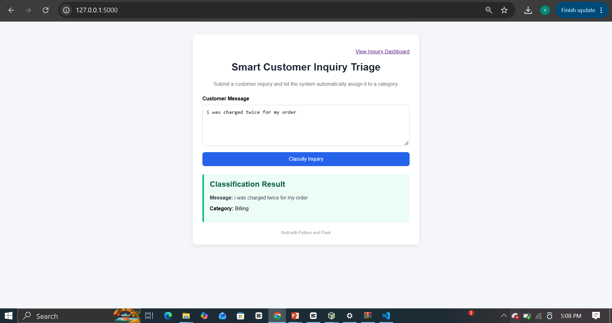
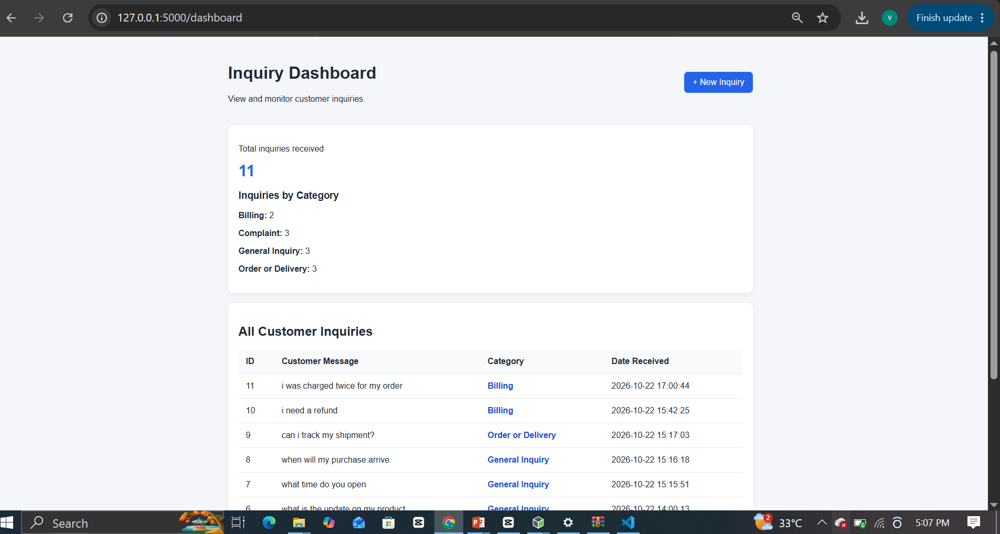

# Smart Customer Inquiry Triage

A beginner-friendly customer support application built with Python and Flask. It automatically categorizes customer inquiries using keyword-based rules and stores submitted messages in an SQLite database.

## Features

- Submit customer inquiries through a web form
- Automatically categorize inquiries
- Store messages in an SQLite database
- View previously submitted inquiries on a dashboard
- Display the total number of inquiries
- Show inquiry counts by category
- Record the date and time each inquiry is received

## Categories

- Billing
- Order or Delivery
- Complaint
- General Inquiry

## Technologies Used

- Python
- Flask
- SQLite
- HTML
- CSS
- Jinja templates

## How It Works

1. A customer submits a message.
2. Python checks the message against predefined keywords.
3. The application assigns a category.
4. The message and category are saved in SQLite.
5. The dashboard displays saved inquiries and category summaries.

## Installation

1. Install Python.
2. Clone or download this repository.
3. Open a terminal in the project folder.
4. Install the dependencies:

   `python -m pip install -r requirements.txt`

5. Start the application:

   `python app.py`

6. Open `http://127.0.0.1:5000` in your browser.

## Project Structure

    smart-customer-inquiry-triage/
    ├── app.py
    ├── requirements.txt
    ├── .gitignore
    └── templates/
        ├── index.html
        └── dashboard.html

The SQLite database is created locally when the application starts.

## Limitations

Classification is based on keywords rather than machine learning or an AI model. Messages containing ambiguous or overlapping keywords may be assigned an incorrect category.

## Future Improvements

- Allow support staff to update inquiry status
- Add search and filtering
- Improve classification accuracy
- Add customer contact details
- Introduce automated notifications

## Author

Built as a practical Python and Flask learning project.

## Screenshots

### Inquiry Form

### Inquiry Dashboard

